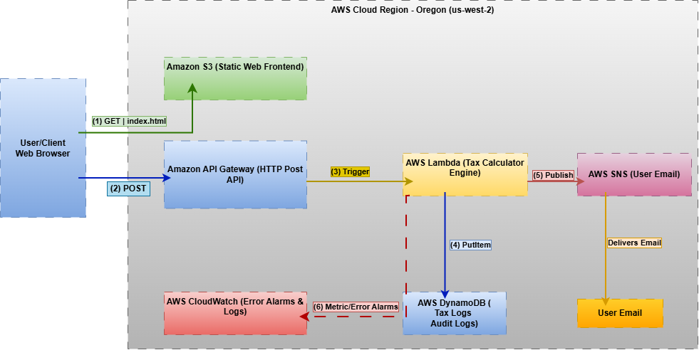

# Serverless California Payroll Tax Estimator

An event-driven serverless web application deployed on AWS that calculates federal, FICA, and California state payroll tax withholdings. The engine accounts for progressive tax brackets, statutory limits (Social Security cap at $168,600), the 0.9% Additional Medicare tax, and California SDI (1.1%), while maintaining an audit trail in DynamoDB.

---

## Architecture Diagram



### Key Architecture Components
* **Amazon S3**: Hosts the static web frontend (`index.html`, `style.css`, `script.js`) configured for public static website hosting.
* **Amazon API Gateway**: REST API managing CORS preflight (`OPTIONS` mock integration) and routing `POST` requests.
* **AWS Lambda (Python 3.12)**: Serverless compute engine executing progressive California and federal tax logic.
* **Amazon DynamoDB**: On-Demand NoSQL table (`PayrollTaxAuditLog`) persisting calculation transactions with single-digit millisecond latency.
* **Amazon SNS**: Decoupled pub/sub topic (`PayrollAlertTopic`) triggering notifications for completed payroll calculations.

---

## Repository Structure & Application Source Documents

```text
├── CloudFront YAML File/
│   └── template.yaml                                   # AWS CloudFormation Infrastructure as Code (IaC) template
├── Payroll Tax Calculator Frontend UI for S3 (website)/# Application Source: Web Client
│   ├── index.html                                      # UI structure, form fields, and tax base disclaimers
│   ├── style.css                                       # Responsive layout and styling
│   └── script.js                                       # Client-side validation & API Gateway integration logic
├── Set Instructions/
│   └── Setup_Instructions.pdf                          # Setup, deployment, and teardown SOP guide
├── Project Screenshots/                                # Console deployment, browser tests, & verification proof
├── architecture-diagram.png                            # Serverless cloud architecture visual
└── README.md                                           # Project documentation and deployment guide
